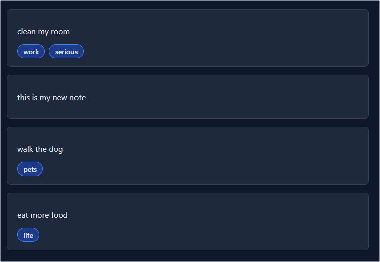

# intro-node-v3
My work from an Intro to Node.js V3 course on https://master.dev/.  This CLI application is built from scratch throughout the course.

  

Course - https://master.dev/courses/node-js-v3/

Slides - https://scottmoss.notion.site/scottmoss/Intro-to-Node-js-V3-7c8e4ccaebf94b839f425fff13dcc44c